<picture>
  <source media="(prefers-color-scheme: dark)" srcset="./profile-dark.svg">
  
</picture>

## Case studies

- [From measuring the funnel to rebuilding the page](https://alinakabanets.com/work/deaku-landing-page): finding where visitors left, then redesigning, rebuilding and instrumenting the landing page.
- [Two healthcare MVPs, designed from scratch](https://alinakabanets.com/work/vigorant-healthcare-mvps): a patient portal and an admin portal, from research to shipped UI.
- [The first metrics layer](https://alinakabanets.com/work/deaku-kpi-tree): a KPI tree from a revenue goal down to design metrics.

## Also

- **AI-native development:** Claude Code with multi-agent workflows, MCP integrations
- **Design:** UX for AI agents, interaction design
- **Mobile:** React Native

[alinakabanets.com](https://alinakabanets.com) · [LinkedIn](https://www.linkedin.com/in/alina-kabanets/) · [aokabanets@gmail.com](mailto:aokabanets@gmail.com)
